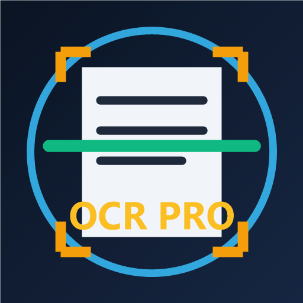
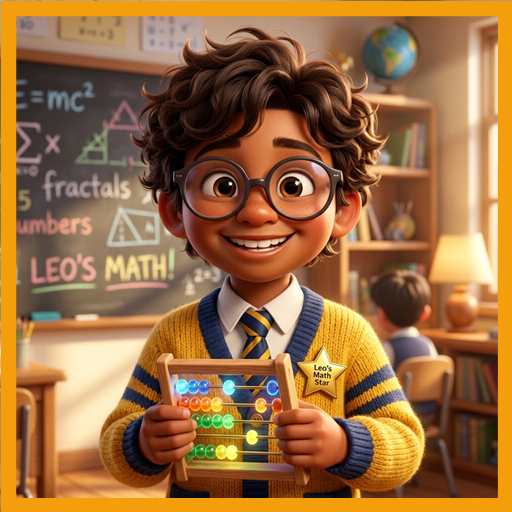
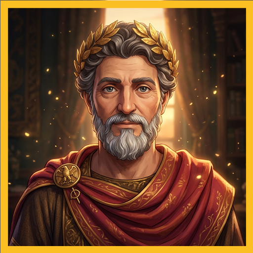

# Wakjira Shewangzaw Dabi

**Mobile & Systems Software Engineer • B.Sc. Computer Science • CompTIA A+ Certified**  
📍 Landshut / Greater Munich Area, Germany • ✉️ [wakjira7@gmail.com](mailto:wakjira7@gmail.com)

-3DDC84?style=flat-square&logo=android&logoColor=white)

---

## 📱 Shipped Mobile Applications Portfolio

I design, engineer, and publish privacy-first, offline-capable mobile applications combining **React Native (Expo SDK 52 + Strict TypeScript)** with **custom native Kotlin computer vision and Android systems modules**.

<table>
  <tr>
    <td width="90" align="center">
      
    </td>
    <td>
      <h3><a href="https://github.com/Wakjira7/omniscan-offline-ocr">OmniScan: Offline PDF OCR Pro</a> <code>com.wakjira.offlineocr</code></h3>
      

        <b>100% On-Device Document Scanner & Multi-Pass Computer Vision OCR Suite.</b> 
        Features a clean-room <b>2,015-LOC native Kotlin vision module</b> (smart sheet auto-crop, projection-profile deskew, 32×32 illumination envelope deshadowing, 64-bit integral-image Sauvola/Wolf–Jolion adaptive binarization, ruled-line suppression), bounded-RAM multi-hundred-page PDF streaming, two-stage contextual layout reconstruction, and zero-dependency searchable <code>.pdf</code> & OpenXML <code>.docx</code> exporters.
      

      

        <a href="https://github.com/Wakjira7/omniscan-offline-ocr"><b>📂 Source & Architecture Docs</b></a> •
        <a href="https://play.google.com/store/apps/details?id=com.wakjira.offlineocr"><b>▶️ Google Play</b></a>
      

    </td>
  </tr>
  <tr>
    <td width="90" align="center">
      
    </td>
    <td>
      <h3><a href="https://github.com/Wakjira7/greatest-minds-smarter7yo">Smarter Than a 7-Year-Old IQ</a> <code>com.wakjira.smarter7yo</code></h3>
      

        <b>100% Offline Multilingual Trivia & Cognitive Ladder.</b> 
        Engineered with synchronous Frame-1 state hydration, question-first UX, 5 interactive classmate partners, persistent subject analytics report cards, and complete <b>9-language localization</b> (<code>EN</code>, <code>AM</code>, <code>DE</code>, <code>SO</code>, <code>AR</code> RTL, <code>ES</code>, <code>FR</code>, <code>PT</code>, <code>JA</code>).
      

      

        <a href="https://github.com/Wakjira7/greatest-minds-smarter7yo"><b>📂 Source & i18n Docs</b></a> •
        <a href="https://play.google.com/store/apps/details?id=com.wakjira.smarter7yo"><b>▶️ Google Play</b></a>
      

    </td>
  </tr>
  <tr>
    <td width="90" align="center">
      
    </td>
    <td>
      <h3><a href="https://github.com/Wakjira7/greatest-minds-smarter7yo">Greatest Minds: Stoic AI Chat</a> <code>com.wakjira.greatestminds</code></h3>
      

        <b>200 Interactive 3D Historical & Stoic AI Mentors Across 10 Mastery Realms.</b> 
        Compiled from a shared multi-variant Expo studio architecture with Material Design 3 live theming, Deno <b>Supabase Edge Functions</b> (server-side Gemini API isolation + sliding-window token caps), deterministic offline Socratic fallback, and CSV/JSON/HTML journal exports.
      

      

        <a href="https://github.com/Wakjira7/greatest-minds-smarter7yo"><b>📂 Source & System Architecture</b></a>
      

    </td>
  </tr>
</table>

---

## ⚙️ Core Engineering Focus

- **On-Device Computer Vision & Classical Image Processing**: Integral-image local adaptive thresholding, illumination envelope estimation, morphological filtering, spatial bounding-box fusion, and bounded-memory bitmap/PDF streaming on mobile hardware.
- **Cross-Platform & Native Mobile Engineering**: Expo SDK 52, React Native, custom Kotlin Expo Modules, Jetpack Compose (Material 3), Room SQLite, WorkManager, Google Play Billing v7, and Android 16 (`API 36`) release engineering.
- **Systems & Infrastructure**: TypeScript, Python, Deno / Supabase Edge Functions, GitHub Actions CI/CD, Linux administration, Active Directory, and network infrastructure.
